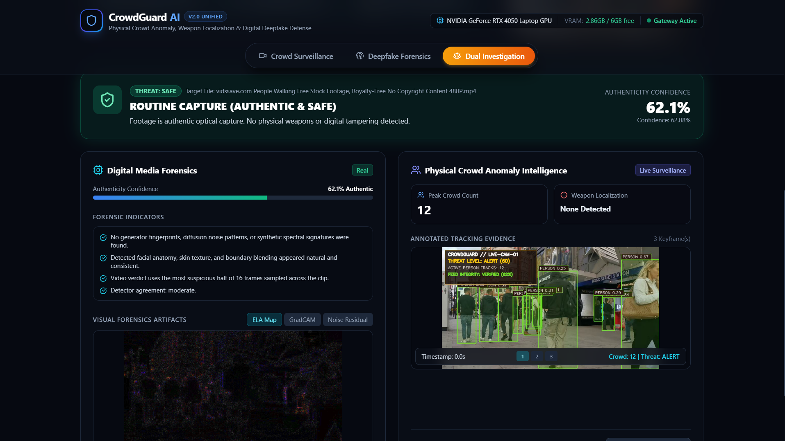
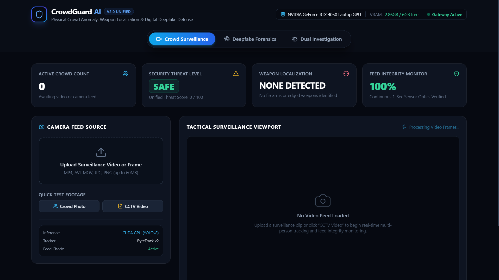
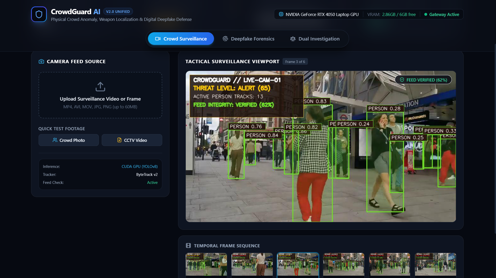
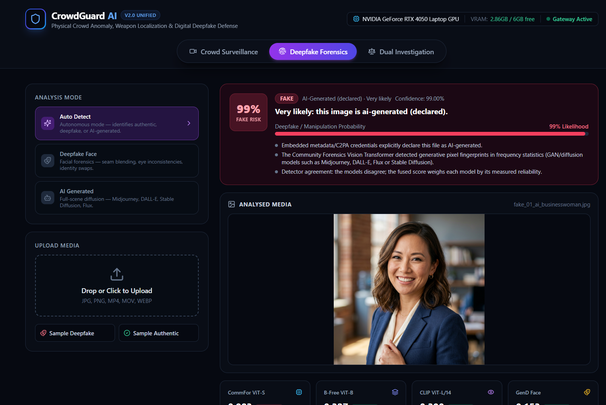

# CrowdGuard AI

**Crowd threat monitoring and deepfake media verification in one system.**

CrowdGuard AI analyses an image or video of a crowd incident in two ways. It counts and tracks people and looks for weapons, and it checks whether the footage itself is AI-generated or face-swapped. Both results are combined into one incident verdict, so that a fabricated clip of an "armed crowd" is not treated as a real emergency.

Built as a college dissertation project (Rashtriya Raksha University). Backend: FastAPI + PyTorch on a single laptop GPU. Frontend: Next.js 14.



---

## Screenshots

| Crowd Surveillance | Crowd tracking on CCTV |
|---|---|
|  |  |

| Deepfake Forensics: verdict and analysed media | Deepfake Forensics: model scores and ELA heatmap |
|---|---|
|  |  |

| Dual Investigation: live pipeline | Dual Investigation: combined verdict |
|---|---|
|  |  |

---

## What it does

**Crowd Surveillance**
- YOLOv8 detection of people, guns and knives (custom `best.pt`), with a MobileNetV3 classifier (`classifier.pth`) that confirms the weapon type.
- Crowd count, fast-movement flag and a risk score (SAFE / ELEVATED / ALERT / DANGER / CRITICAL).
- Annotated keyframes and a frame-by-frame timeline for videos.

**Deepfake Forensics** (modes: Auto, Deepfake face, AI-generated)
- Whole-image detectors: Community Forensics ViT-S/16 (CVPR 2025), B-Free DINOv2 ViT-B (CVPR 2025), UniversalFakeDetect CLIP ViT-L/14.
- Face detector: GenD CLIP ViT-L/14 (WACV 2026), run in a separate worker process.
- Each score is Platt-calibrated and the scores are combined by a logistic model fitted on labelled public data (`CrowdGuardAI/data/calibration.json`).
- Evidence: ELA map, ViT attention map, noise residual, EXIF and C2PA metadata.
- If a check cannot run (for example the face worker is down), the result says **Inconclusive** with a warning instead of reporting "authentic".

**Dual Investigation**
- Runs **Stage 1 Crowd Surveillance → Stage 2 Deepfake Forensics → Stage 3 Cross-Verification**, with live progress streamed to the browser.
- Verdicts: fabricated threat, media manipulation, verified physical incident, verified crowd surge, routine capture.

---

## Measured accuracy (images)

Held-out test split of 1,010 image variants (Defactify, DeepFakeFace and GenD sample crops; each image scored as the original and as a JPEG q85 copy). Version 1 was the earlier hand-tuned pipeline.

| | Fakes detected | Real images correct | Balanced accuracy | AUC |
|---|---|---|---|---|
| Version 1 | 62% | 76% | 69% | – |
| **Current** | **79%** | **96%** | **88%** | **0.943** |

False alarms on real faces fell from 43% to 3%. Weak spots: DALL-E 3 images (40% detected) and InsightFace face swaps (46%). Video accuracy is not measured yet; the Celeb-DF test set and script are ready (`tools/eval_video.py`). Full details are in the [dissertation report](docs/report/CrowdGuardAI_Report.md).

---

## Quick start

Requirements: Windows 10/11, NVIDIA GPU with CUDA (tested on an RTX 4050 6 GB), Python 3.12, Node.js 20+.

### 1. Install

```powershell
git clone --recurse-submodules https://github.com/sauravmathur02/CrowdGuard-AI.git
cd CrowdGuard-AI
python -m venv venv_gend
venv_gend\Scripts\pip install -r requirements.txt -r requirements_gend.txt
cd frontend
npm install
npm run build
cd ..
```

### 2. Model weights (not stored in git)

| File / folder | Put it in | Source |
|---|---|---|
| `best.pt` (YOLOv8: person, gun, knife) | `CrowdGuardAI/pretrained_weights/` | [sentinelvision-ai-surveillance](https://github.com/sauravmathur02/sentinelvision-ai-surveillance/tree/main/project/models) |
| `classifier.pth` (MobileNetV3 gun/knife) | `CrowdGuardAI/pretrained_weights/` | same as above |
| `yolo_crowd.pt` (YOLOv8n, fallback if `best.pt` is missing) | `CrowdGuardAI/pretrained_weights/` | Ultralytics `yolov8n.pt`, renamed |
| `fc_weights.pth` (UniversalFakeDetect head) | `CrowdGuardAI/pretrained_weights/` | [UniversalFakeDetect](https://github.com/WisconsinAIVision/UniversalFakeDetect) |
| `GenD/` | `CrowdGuardAI/pretrained_weights/GenD/` | Hugging Face `yermandy/GenD_CLIP_L_14` |
| `BFREE_dino2reg4/` | `CrowdGuardAI/detectors/B-Free/code/weights/` | [B-Free weights](https://github.com/grip-unina/B-Free/tree/main/code) (MD5 f3f53fa647848b16cf81c913f148a198) |

Community Forensics (`OwensLab/commfor-model-384`) and the OpenCV face-detector files download automatically on first run.

### 3. Run

Double-click **`run_crowdguard.bat`**, wait about 2–3 minutes for the models to load, then open **http://localhost:3000**.

Or run it manually in two terminals:

```powershell
# Terminal 1: backend (port 8000, starts the GenD worker on 8001)
cd CrowdGuardAI
..\venv_gend\Scripts\python.exe -m uvicorn app:app --host 0.0.0.0 --port 8000

# Terminal 2: frontend (port 3000)
cd frontend
npm run start      # run `npm run build` first after any frontend change
```

Check readiness at http://localhost:8000/api/health (`"ensemble_ready": true`). API docs: http://localhost:8000/docs.

---

## API

| Method | Endpoint | Purpose |
|---|---|---|
| GET | `/api/health` | GPU memory, loaded models, calibration status |
| POST | `/api/crowd/detect` | Crowd analysis of one image |
| POST | `/api/crowd/video` | Crowd analysis of a video (keyframes + timeline) |
| POST | `/predict` | Deepfake analysis (`mode`: auto, deepfake, ai_generated) |
| POST | `/api/predict/stream` | Same, with stage-by-stage progress (SSE) |
| POST | `/api/investigate` | Dual investigation (crowd → forensics → verdict) |
| POST | `/api/investigate/stream` | Same, with live progress (SSE) |
| POST | `/fetch-url` | Download media from a URL |
| POST | `/feedback` | Store an operator correction |

---

## Reproducing the evaluation

```powershell
cd CrowdGuardAI
..\venv_gend\Scripts\python.exe tools\build_eval_set.py     # download labelled images
..\venv_gend\Scripts\python.exe tools\calibrate.py          # score, fit calibration, report held-out accuracy
..\venv_gend\Scripts\python.exe tools\build_video_eval.py   # download Celeb-DF v2 test videos
..\venv_gend\Scripts\python.exe tools\eval_video.py         # fit video fusion, report video accuracy
```

---

## Project structure

```
CrowdGuardAI/            FastAPI backend
  app.py                 routes, forensics pipeline, dual investigation
  gend_worker.py         GenD face worker (port 8001)
  crowd/                 YOLO detector, smoothing, behaviour, risk engine, weapon classifier
  detectors/             CommFor, B-Free, CLIP, calibration, fusion (ensemble.py), video, ELA/heatmaps
  data/                  calibration.json (fitted), eval_scores.json
  tools/                 dataset download, calibration and video evaluation scripts
  pretrained_weights/    model weights (not in git)
frontend/                Next.js 14 console
  src/components/        Surveillance, Forensics, Investigation, PipelineTracker, MediaPreview
  src/lib/api.ts         typed API client (incl. SSE streaming)
  public/static/samples/ demo images and videos
docs/report/             dissertation (Markdown + Overleaf LaTeX, RRU format)
docs/screenshots/        UI screenshots
archive/                 legacy code (UniversalFakeDetect, sentinelvision submodule)
run_crowdguard.bat       one-click launcher
```

---

## Roadmap (Review 2)

- Video accuracy on Celeb-DF and a fitted video fusion model.
- Optical-flow crowd motion analysis and multi-camera RTSP streams.
- Signed PDF incident reports and an incident database.
- More generators (Flux, SD 3.5) and messaging-app compression in the calibration set.

---

## Credits and licences

Uses published models and data: Community Forensics (Park & Owens, CVPR 2025), B-Free (Guillaro et al., CVPR 2025), UniversalFakeDetect (Ojha et al., CVPR 2023), GenD (Yermakov et al., WACV 2026), Ultralytics YOLOv8, ByteTrack, Defactify, DeepFakeFace, FaceForensics++ and Celeb-DF. **B-Free's licence permits non-profit use only.** Check each model's licence before any commercial use.
